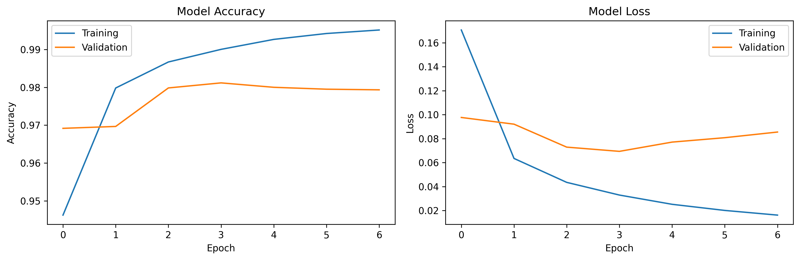
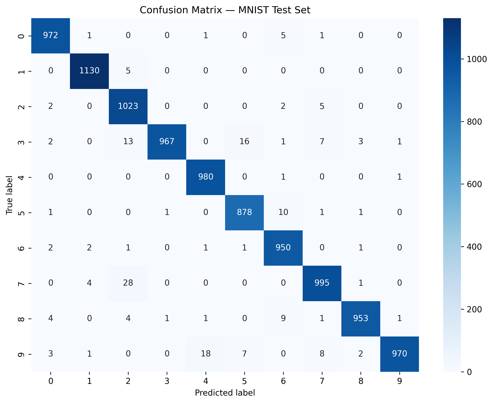
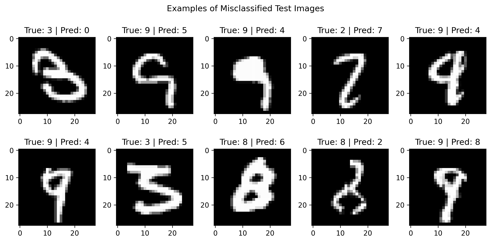
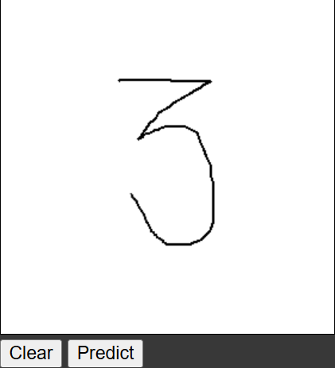
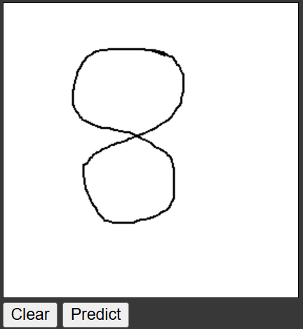

# Handwritten Digit Recognition using CNN

A Convolutional Neural Network (CNN) trained on the **MNIST handwritten digit dataset** to classify digits from 0 to 9, with an interactive drawing canvas for inference in Google Colab.

The project combines image preprocessing, exploratory statistical analysis, deep learning, model evaluation and a lightweight interactive interface.

## Project Highlights

- Trains a CNN on 28 × 28 grayscale MNIST images.
- Explores digit-class frequencies and pixel-intensity characteristics.
- Uses validation-based early stopping during model training.
- Evaluates performance using accuracy, a classification report and a confusion matrix.
- Provides a Google Colab drawing canvas for handwritten digit prediction.
- Displays the predicted digit and its Softmax score.
- Includes a saved Keras model for inference.

## Dataset

The project uses the [MNIST database of handwritten digits](https://www.tensorflow.org/datasets/catalog/mnist).

| Property | Description |
|---|---|
| Original training partition | 60,000 images |
| Training subset | 54,000 images |
| Validation subset | 6,000 images |
| Official test partition | 10,000 images |
| Image dimensions | 28 × 28 pixels |
| Image channels | 1 (grayscale) |
| Classes | 10 (digits 0–9) |

The original training partition is divided into training and validation subsets using a stratified split. The official test partition is kept separate for final evaluation.

Images are normalized to the range `[0, 1]` and reshaped to `(28, 28, 1)` for CNN input. Labels are one-hot encoded for model training.

## CNN Architecture

| Layer | Configuration |
|---|---|
| Input | 28 × 28 × 1 |
| Convolution | 84 filters, 3 × 3, ReLU, He uniform initialization |
| Max pooling | 3 × 3 |
| Convolution | 32 filters, 4 × 4, ReLU |
| Max pooling | 2 × 2 |
| Flatten | — |
| Dense | 256 units, ReLU |
| Output | 10 units, Softmax |

**Trainable parameters:** 79,474

### Training Configuration

| Parameter | Value |
|---|---|
| Optimizer | SGD |
| Learning rate | 0.01 |
| Momentum | 0.9 |
| Loss | Categorical cross-entropy |
| Batch size | 32 |
| Maximum epochs | 15 |
| Early stopping | Validation loss, patience 3 |
| Best weights | Restored after early stopping |

Training stopped after seven completed epochs in the reported run. Early stopping restores the model weights from the epoch with the best validation loss.

## Exploratory Data Analysis

The notebook includes:

- Digit-class frequency distribution.
- Overall normalized pixel-intensity distribution.
- Class-wise pixel mean, standard deviation and variance.
- Mean-image visualization for each digit.
- Distribution of non-zero pixels per image.
- Chi-square goodness-of-fit test for digit-class frequencies.

These analyses describe the dataset and should not be interpreted as measures of classifier performance.

## Model Evaluation

The revised model was evaluated on the separate official MNIST test partition containing 10,000 images.

### Reported Results

| Metric | Result |
|---|---:|
| Training accuracy | 99.5% |
| Best validation accuracy | 97.1% |
| **Test accuracy** | **98.18%** |
| Correct test predictions | 9,818 |
| Incorrect test predictions | 182 |

The test accuracy is calculated on the official test partition, which was not used for training or validation-based model selection.

### Training History

The following plots show training and validation accuracy and loss across the completed epochs.



### Confusion Matrix

The confusion matrix summarizes correct and incorrect predictions for each digit class.



### Misclassified Examples

The following examples illustrate handwritten digits that the model classified incorrectly.



The notebook also generates a per-class classification report containing precision, recall and F1-score.

## Interactive Digit Recognition

The notebook includes an HTML Canvas drawing interface embedded in Google Colab.

1. Draw a single digit (0–9) on the canvas.
2. Select **Predict**.
3. The drawing is transferred to the Python runtime.
4. The image is converted to grayscale, resized to 28 × 28 pixels, inverted and normalized.
5. The CNN predicts the digit and displays its predicted class and Softmax score.

The interactive interface uses Google Colab's JavaScript callback bridge. It is designed for Google Colab and will not run unchanged in a standard local Jupyter Notebook.

### Example Predictions

| User-drawn digit | Model prediction |
|---|---|
|  | 3 |
|  | 8 |

## Saved Model

The trained model is saved in Keras format:

`models/recognizer.keras`

It can be loaded for inference without retraining:

```python
from tensorflow.keras.models import load_model

model = load_model("models/recognizer.keras")
```

The saved model contains the trained network architecture and weights.


## Run the Project

### Option 1: Google Colab (Recommended)

1. Open `notebooks/Handwritten_Digit_Recognizer.ipynb`.
2. Upload the notebook to Google Colab or open it from GitHub.
3. Run the cells sequentially.
4. Complete training and evaluation.
5. Run the final GUI cells to draw and predict digits.

Google Colab is required for the interactive drawing interface.

### Option 2: Local Notebook

The model training and evaluation sections use standard Python libraries and can be adapted to a local Jupyter environment. The Colab-specific interactive GUI cells require Google Colab.

Install the dependencies:

```bash
pip install -r requirements.txt
```

Launch Jupyter:

```bash
jupyter notebook
```

Open the notebook under `notebooks/` and run the training and evaluation sections. Skip the Colab-specific GUI cells when running locally.


## Limitations and Future Improvements

- The current model recognizes one digit at a time.
- Handwriting that differs substantially from MNIST may reduce prediction reliability.
- The canvas preprocessing does not yet include bounding-box centering or deskewing.
- Future work could explore multi-digit recognition, user-generated training examples, improved preprocessing and deployment as a web or mobile application.

## Technologies

Python · TensorFlow/Keras · NumPy · Pandas · Matplotlib · Seaborn · SciPy · scikit-learn · Pillow · HTML · CSS · JavaScript · Google Colab

## Acknowledgement

Developed as a capstone project for the Advanced Course in Data Science & AI, Savitribai Phule Pune University, academic year 2024–2025.

Code implementation and technical development: **Sanskruti Joshi**.
